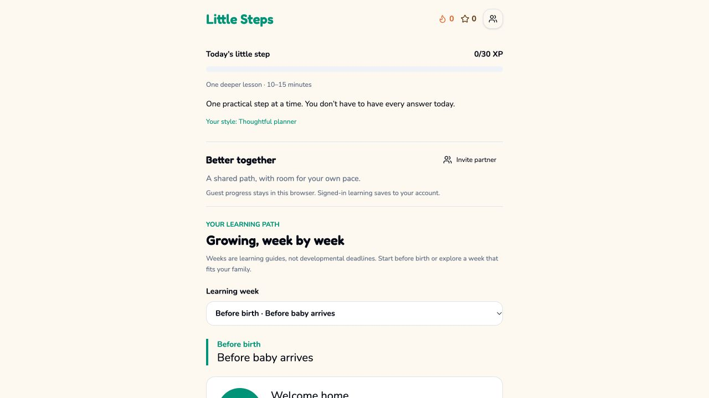
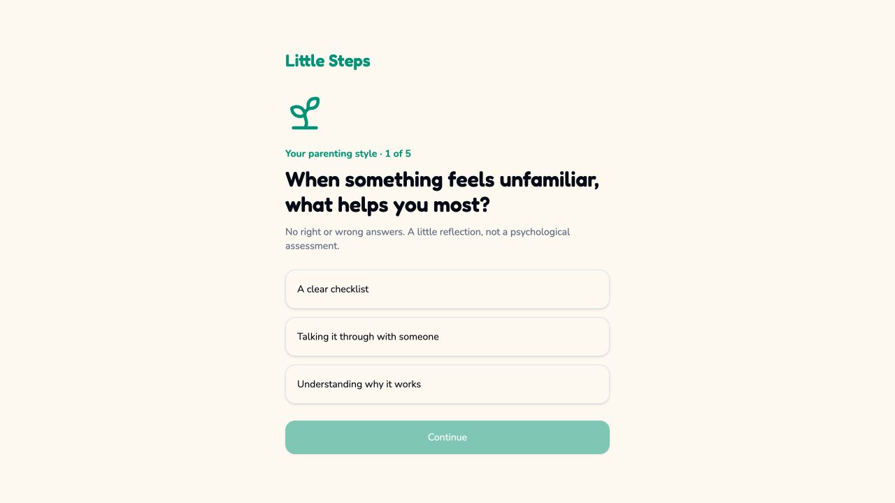
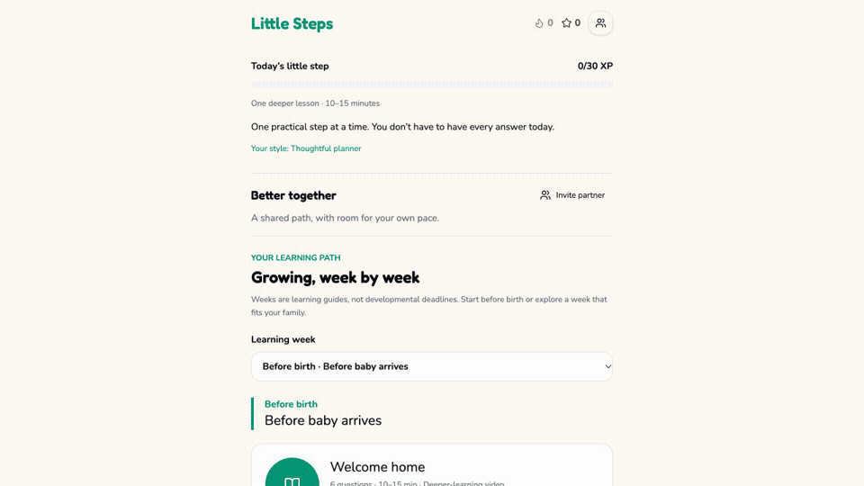
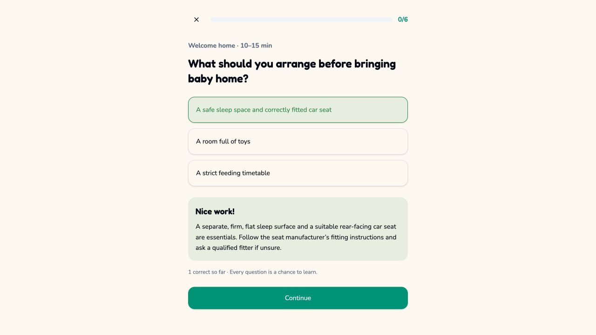

<div align="center">


# Little Steps

### Small lessons for one of life’s biggest learning curves.

**A Duolingo-style micro-learning platform that helps expecting and first-time parents build practical knowledge in 10–15 minutes a day.** Little Steps pairs week-based lessons and quizzes with personalized encouragement, progress mechanics, and a shared co-parenting space.

[](https://react.dev/)
[](https://www.typescriptlang.org/)
[](https://tanstack.com/start)
[](https://tailwindcss.com/)
[](https://vitest.dev/)
[](LICENSE)

</div>

## Why Little Steps?

Parenting guidance is abundant, but it is often fragmented across long articles, videos, apps, and conflicting advice. New parents need a calmer way to learn what matters now, remember it, and stay engaged without turning preparation into another full-time job.

Little Steps organizes that information into a structured learning path spanning pregnancy through the toddler years. Each day combines a short lesson, a knowledge check, immediate teaching feedback, and an optional expert-led video for parents who want to go deeper.



## Key Features

### A curriculum that grows with the child

- **18 developmental stages** organize content from pre-birth through 105–156 weeks.
- **Daily 10–15 minute lessons** make learning manageable during an already busy season.
- **Curated deep dives** connect concise in-app guidance to longer external videos.

### Feedback designed for learning

- **Multi-question quizzes** check understanding instead of rewarding passive completion.
- **Immediate pedagogical feedback** explains why an answer is right or wrong while the idea is still fresh.
- **Parenting-style onboarding** adjusts motivational language and encouragement without changing the underlying learning goals.



### Gamification with a trustworthy source of truth

- **30 XP daily goals and streaks** turn steady learning into a visible habit.
- **Canonical server-side scoring** is designed to validate completed work before awarding XP, so the browser cannot forge progress.
- **Separate streaks for each parent** preserve individual accountability inside a shared family experience.

### Co-parenting without shared credentials

- **Revocable invitation codes** let a parent add or remove a partner without sharing an account.
- **PostgreSQL Row-Level Security policies** are designed to scope family data to authorized members at the database boundary.
- **Shared progress views** help partners coordinate while keeping personal learning records distinct.



### Useful with or without an account

- **Guest mode** lowers the barrier to trying the learning experience.
- **Local storage fallback** keeps local progress available when a network connection or signed-in session is unavailable.

## Architecture and Engineering Highlights

```text
React 19 client
   ├── signed-in experience ──▶ TanStack server functions ──▶ PostgreSQL + RLS
   │                                  └── canonical XP / progress rules
   └── guest or offline mode ─▶ localStorage fallback
```

- **Server-owned scoring:** quiz submissions cross a server boundary before XP, hearts, or streak state is accepted. This keeps client state responsive without treating it as authoritative.
- **Database-enforced partner isolation:** family-space access is modeled through membership and invitation records, with RLS intended as a second authorization boundary beneath the application layer.
- **Edge-ready request handling:** TanStack Start combines React SSR with server functions, while the Nitro build targets Cloudflare by default.
- **Progressive local experience:** guest and offline flows keep the core lesson loop usable while preserving a clear boundary between device-local progress and authenticated server records.
- **Typed full-stack contracts:** TypeScript spans components, server functions, and shared domain types, reducing drift between the UI and backend behavior.



## Tech Stack

| Layer                | Technology                                                                                                             | Why it fits                                                                                            |
| -------------------- | ---------------------------------------------------------------------------------------------------------------------- | ------------------------------------------------------------------------------------------------------ |
| Full-stack framework | [TanStack Start v1](https://tanstack.com/start)                                                                        | Provides file-based routing, React SSR, and typed server functions in one Vite-based application.      |
| UI runtime           | [React 19](https://react.dev/)                                                                                         | Supports composable learning flows and responsive feedback-heavy interactions.                         |
| Language             | [TypeScript](https://www.typescriptlang.org/)                                                                          | Keeps lesson, quiz, progress, and server contracts explicit across the stack.                          |
| Styling              | [Tailwind CSS v4](https://tailwindcss.com/)                                                                            | Enables fast, consistent interface work with a small styling surface.                                  |
| Components           | [Radix UI](https://www.radix-ui.com/), shadcn tokens, [Lucide](https://lucide.dev/)                                    | Supplies accessible primitives, reusable design tokens, and a coherent icon set.                       |
| Data                 | [PostgreSQL](https://www.postgresql.org/) with RLS                                                                     | Supports relational learning/progress data and database-level access policies for co-parenting spaces. |
| Server boundary      | TanStack `createServerFn`                                                                                              | Keeps trusted scoring and data mutations off the client while retaining typed calls.                   |
| Tooling              | [Vite](https://vite.dev/)                                                                                              | Delivers a quick local feedback loop and an optimized production build.                                |
| Testing              | [Vitest](https://vitest.dev/) + [React Testing Library](https://testing-library.com/docs/react-testing-library/intro/) | Covers domain rules and user-visible behavior with a React-friendly test stack.                        |

## Local Development

### Prerequisites

- [Bun](https://bun.sh/) or Node.js 20+
- A PostgreSQL database

### 1. Clone the repository

```bash
git clone https://github.com/AjaneeI/little-steps.git
cd little-steps
```

### 2. Install dependencies

Use one package manager consistently:

```bash
bun install
```

or:

```bash
npm install
```

### 3. Configure the environment

Copy the safe template and supply credentials for your Supabase project:

```bash
cp .env.example .env.local
```

The browser uses the `VITE_SUPABASE_*` values. `SUPABASE_SERVICE_ROLE_KEY` is server-only and must never be exposed through a `VITE_` variable or committed to Git.

### 4. Start the development server

```bash
bun run dev
```

The equivalent npm command is `npm run dev`.

### 5. Run the tests

```bash
bun test
```

The equivalent npm command is `npm test`.

## Testing Strategy

The test suite is designed around the places where incorrect behavior would be most costly:

- **Unit tests** cover XP calculations, daily-goal and streak transitions, heart consumption, invitation rules, and lesson/quiz domain logic.
- **Integration tests** exercise lesson completion, immediate answer feedback, onboarding personalization, guest persistence, and authenticated co-parent flows through the UI and server boundary.
- **Security-focused database checks** should verify that RLS policies reject cross-family reads and writes, revoked invitations lose access, and client-supplied XP cannot override canonical scoring.

## Product Tour

The screenshots above show onboarding, the week-based dashboard, immediate quiz feedback, and the authenticated co-parenting controls. The invitation code is deliberately hidden in the demo asset so a live credential is never published.

## Medical Disclaimer

Little Steps is an educational micro-learning tool. It does not provide medical diagnosis or treatment and is not a substitute for advice from a pediatrician, obstetrician, midwife, or other qualified healthcare professional. Always seek clinical guidance for questions about a parent’s or child’s health, development, or safety.

## License

Released under the [MIT License](LICENSE).
